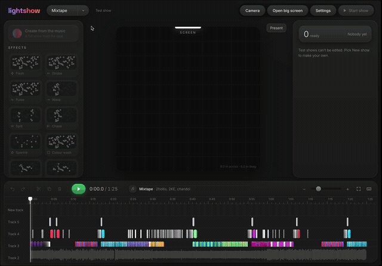
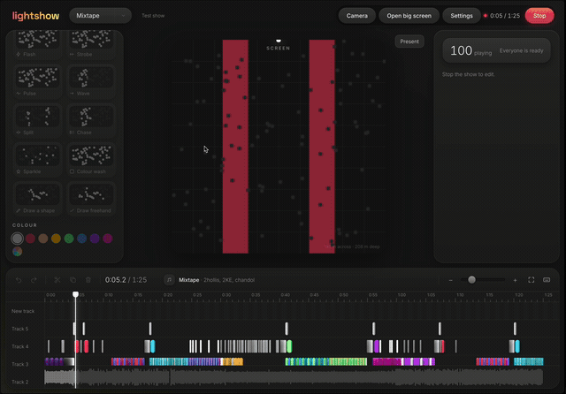

# lightshow

An easy to use, minimal-setup, synchronised crowd light show platform. Participants only need their phone.

A host draws a venue, imports an audio track, and paints colour onto a timeline as clips — not frames. At the show, each participant's phone finds its own seat with its camera, syncs to a shared clock, and plays back the slice of the show assigned to that seat.

## Demo

**Editor** — effects library, venue preview and a multi-track clip timeline.

**Rehearsal** — simulate up to 100 phones joining a session before any real participant connects.

**Playback, from the booth** — the editor's own preview pane running the live show in real time.

**The room** — the venue's 3D view with every simulated seat lit and changing colour in sync.

On the night, a real audience scans a join code, points their phone's camera at the big screen to find their seat, and taps ready — no demo needed for that part, just a phone.

## Docs

- [`SPEC.md`](SPEC.md) — what to build
- [`DEVELOPMENT.md`](DEVELOPMENT.md) — chunk plan
- [`AGENTS.md`](AGENTS.md) — project conventions

## License

[O'Saasy License](LICENSE.md)
