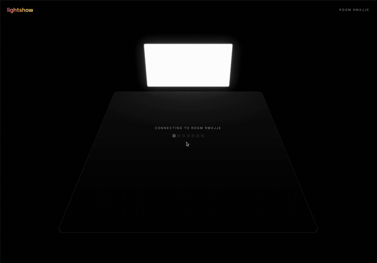
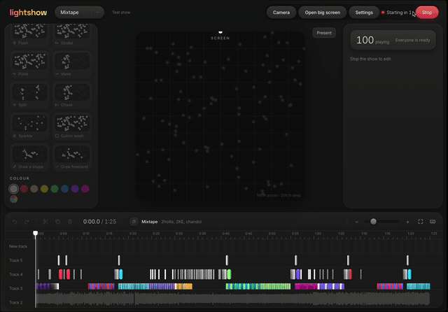

# lightshow

An easy to use, minimal-setup, synchronised crowd light show platform. Participants only need their phone.

A host masks out the shape of the venue, imports an audio track, and paints colour onto a timeline. At the show, each participant's phone finds its own seat with its camera, synchronised with the server, and materialises those colors through light.

## Demo

**Editor** — effects library, venue preview and a multi-track clip timeline. Or an auto generated show via deterministic algorithms, deconstructing 3 tiers of frequency and applies preset based on what fits the given region.

**Test harness** — simulate N phones joining a session before any real participant connects. Stress test infrastructure, connectivity, and preview your show.

**Playback, from the booth** — the editor's own preview pane running the live show in real time.

**Playback, a bird's eye view** — the venue's 3D view with every simulated seat lit and changing colour in sync.

On the night, a real audience scans a join code, points their phone's camera at the big screen to find their seat through an ingenious algorithm, and taps ready. Larger venues can be supported through more involved algorithms, triangulating position through readily available signals.

## License

[O'Saasy License](LICENSE.md)
